<div align="center">


### Plataforma de gestión para grupos de running

Planificación de entrenamientos, asistencia, cuotas, documentación médica y métricas de rendimiento en un solo lugar.
Desarrollada y desplegada para un grupo de entrenamiento real.

[](https://github.com/MarcosBarberis/RunTrack-Portfolio/actions/workflows/ci.yml)


**[▶ Probar la demo](https://marcosbarberis.github.io/RunTrack-Portfolio/)** ·
[Capturas](#capturas) ·
[Arquitectura](#arquitectura) ·
[Decisiones técnicas](#desafíos-y-decisiones-técnicas) ·
[Correr en local](#correr-en-local)

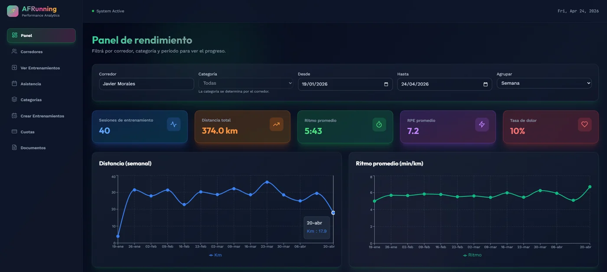

</div>

---

## Qué resuelve

Un coach que entrena a decenas de corredores necesita saber, cada semana, quién vino, quién está al día con la cuota, a quién se le vence el apto médico y cómo evoluciona el grupo. RunTrack reúne todo eso en un panel y le da a cada runner su propio espacio para ver el plan y cargar sus resultados.

- **Para el coach:** alta y baja de corredores, categorías, planificación de entrenamientos, control de asistencia, registro de pagos, seguimiento de deslinde y EMMAC, reportes filtrables y alertas automáticas.
- **Para el runner:** plan según su categoría, registro de asistencia y resultados (distancia, tiempo, esfuerzo, molestias), entrenamientos libres, estado de su cuota y rachas de asistencia.
- **Reglas automáticas:** la cuota pasa de *al día* a *por vencer* y *vencida*; tras 7 días de gracia el plan se bloquea solo. El EMMAC vence en el próximo cumpleaños y avisa 30 días antes.

> **Demo:** la versión publicada corre 100 % en el navegador con datos ficticios. Entrá como coach con `coach` / `demo1234` o como runner con el DNI `30111222`.

## Capturas

| Panel del coach | Cuotas y bloqueo automático |
|---|---|
|  | 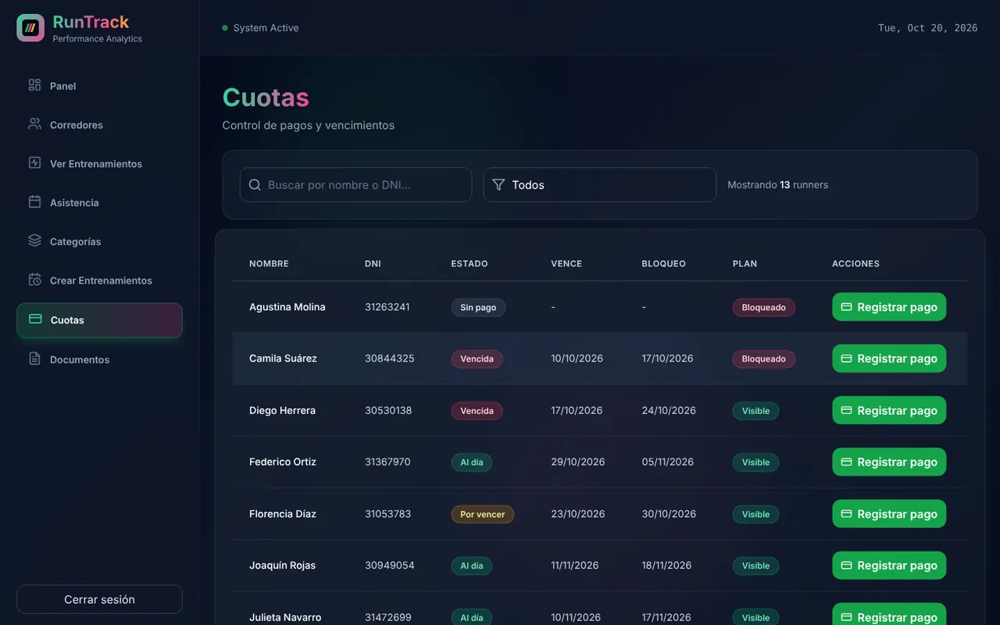 |
| **Corredores** con alerta de cumpleaños | **Documentación** (deslinde y EMMAC) |
| 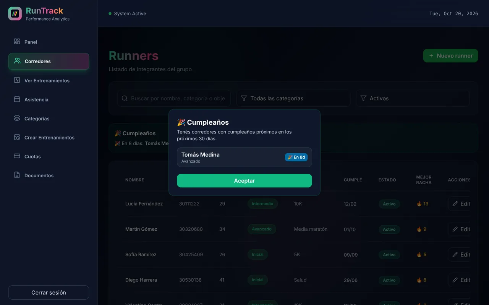 | 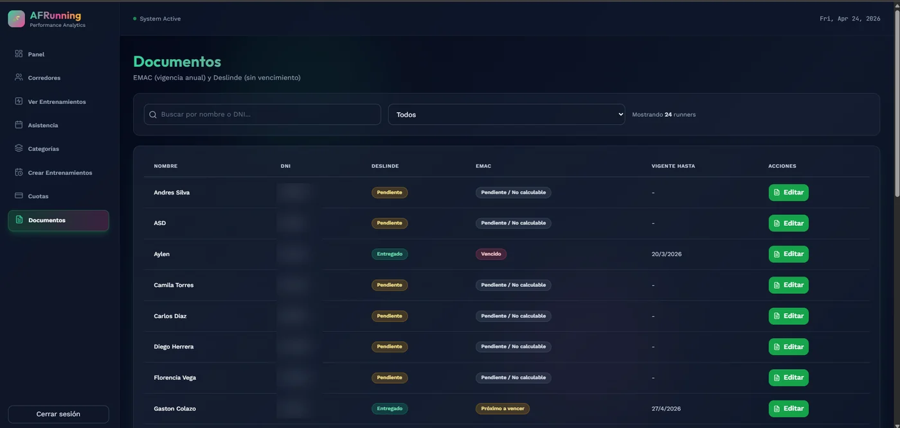 |
| **Planificación** de entrenamientos | **Asistencia** con exportación a CSV |
| 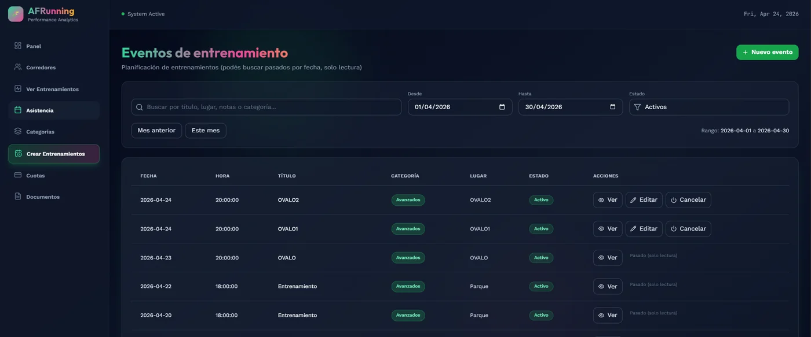 | 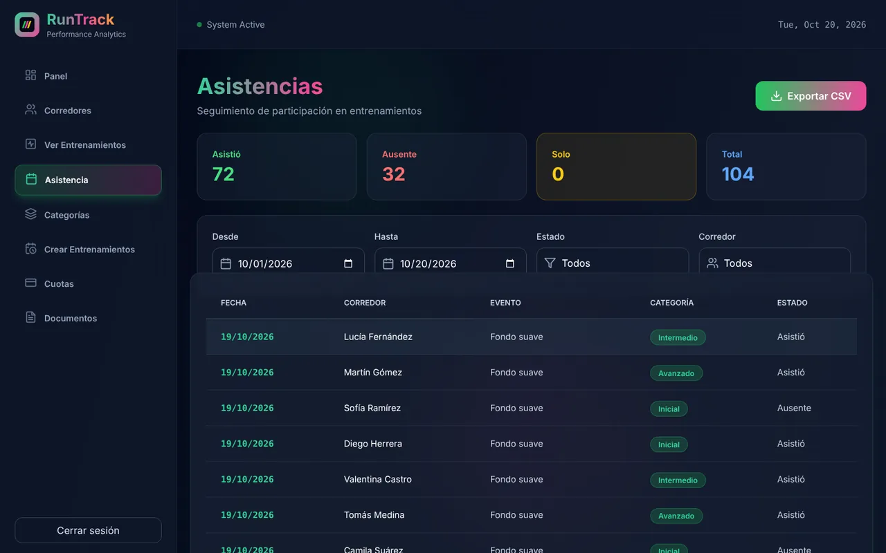 |

<table>
  <tr>
    <th>Vista del runner (móvil)</th>
    <th>Carga de un entrenamiento</th>
    <th>Landing</th>
  </tr>
  <tr>
    <td width="25%">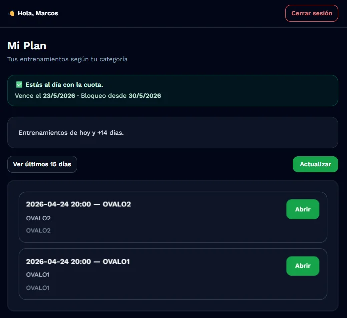</td>
    <td width="25%">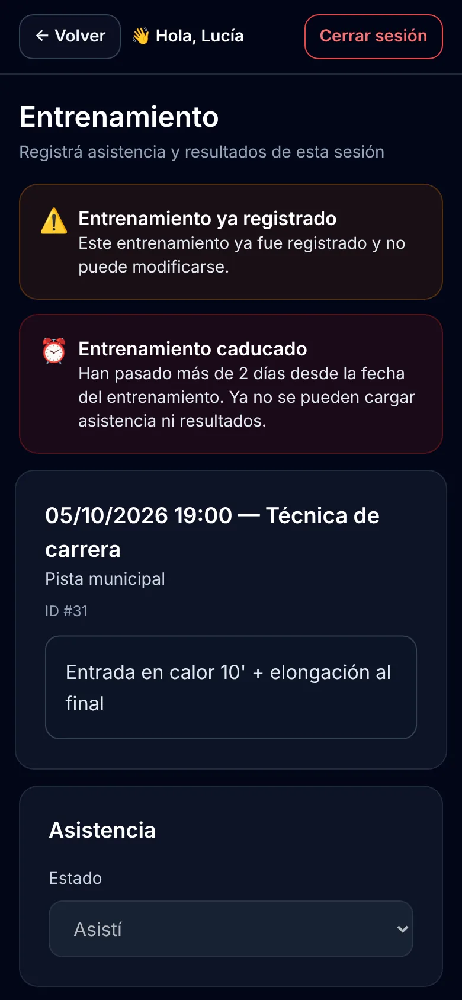</td>
    <td width="50%">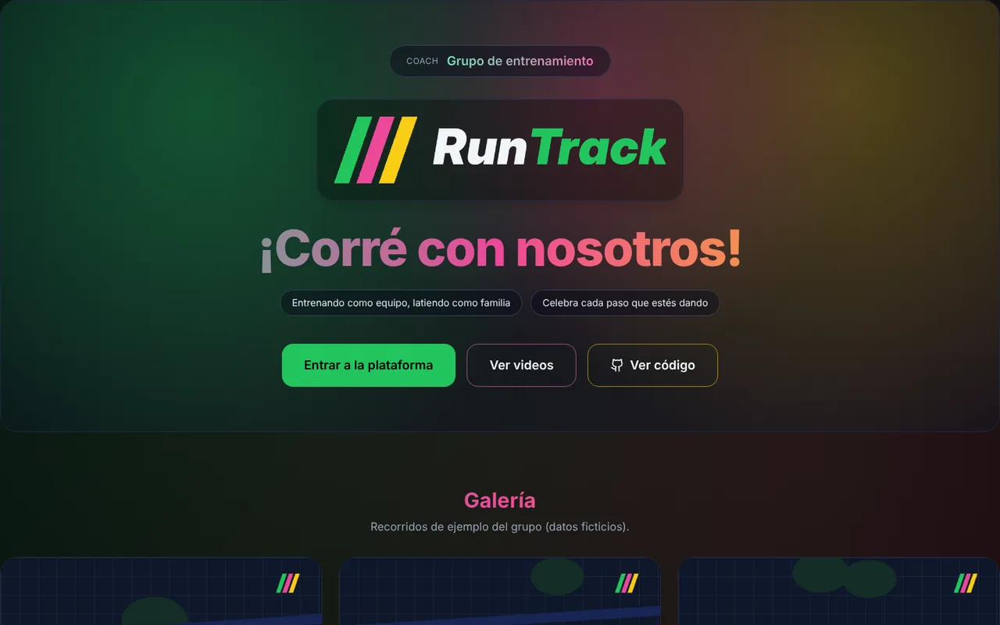</td>
  </tr>
</table>

<sub>Todas las capturas usan datos ficticios de la demo.</sub>

## Funcionalidades

<details open>
<summary><b>Rol Coach</b></summary>

| Módulo | Qué permite |
|---|---|
| Panel | KPIs (sesiones, km, ritmo, RPE, tasa de dolor) y series semanales o mensuales, filtrables por runner, categoría y fechas |
| Corredores | Alta, edición, baja lógica, categoría, objetivo, rachas y cumpleaños próximos |
| Entrenamientos | Planificación con fecha, hora, lugar, categoría y notas; cancelación sin borrar historial |
| Asistencia | Reporte por evento y por runner; las ausencias se infieren cuando el runner no registra nada |
| Cuotas | Registro de pagos (1 a 12 meses), estado automático y bloqueo del plan |
| Documentos | Deslinde (sin vencimiento) y EMMAC (vence en el cumpleaños) con alertas |
| Reportes | Exportación a CSV de entrenamientos y asistencia |

</details>

<details>
<summary><b>Rol Runner</b></summary>

- Plan de entrenamientos de su categoría (ventana de ±15 días).
- Registro de asistencia y resultados: distancia, tiempo, RPE de 1 a 5, molestias y notas.
- Entrenamientos libres fuera del plan.
- Estado de la cuota y de la documentación, con avisos antes del vencimiento.
- Rachas de asistencia (actual y mejor histórica).
- Fecha de nacimiento y aceptación de términos en el primer ingreso.

</details>

<details>
<summary><b>Reglas de negocio</b></summary>

**Entrenamientos**
- No se cargan entrenamientos futuros.
- La carga se habilita hasta 2 días después del evento.
- Un solo registro por runner y entrenamiento.

**Membresía**
- Ciclo de 30 días desde el último pago.
- *Por vencer* desde 5 días antes del vencimiento.
- Período de gracia de 7 días; después, el plan se bloquea automáticamente.

**Documentación**
- Deslinde obligatorio, sin vencimiento.
- EMMAC vigente hasta el próximo cumpleaños, con alerta 30 días antes.

**Runners**
- DNI único. Solo los runners activos pueden ingresar; un runner dado de baja pierde el acceso aunque tenga una sesión abierta.

</details>

## Arquitectura

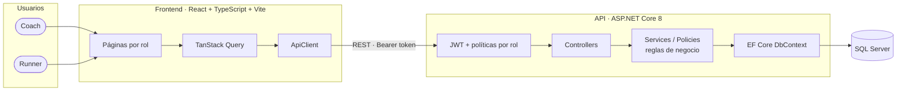

**Backend:** API REST en capas (controllers, servicios con las reglas de negocio, `DbContext` y entidades de dominio). Las reglas que se repiten, como la ventana de carga de entrenamientos, viven en una política inyectable (`IRunnerActionsPolicy`) para que todos los endpoints las apliquen igual.

**Frontend:** SPA en React con rutas protegidas por rol, estado de servidor con TanStack Query, gráficos con Recharts y estilos con Tailwind.

### Modelo de datos

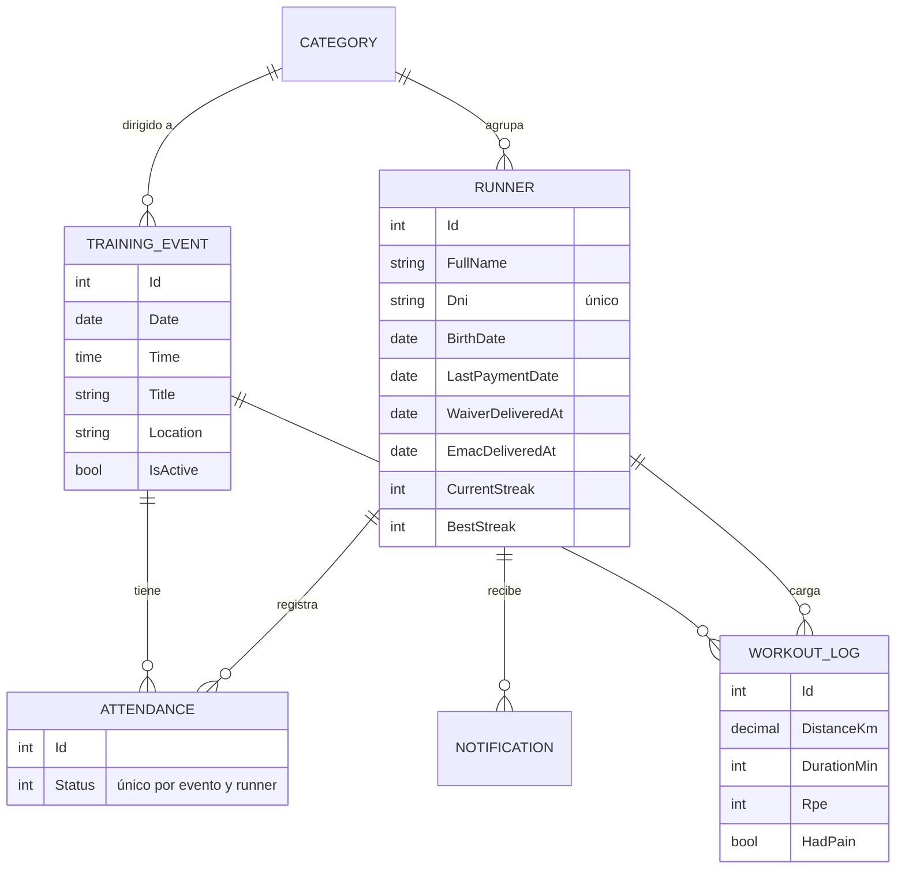

## Desafíos y decisiones técnicas

**Bloqueo automático por cuota.** El estado de la membresía no se guarda: se calcula en cada consulta a partir de la fecha del último pago, el ciclo y los días de gracia. Así nunca queda desincronizado y no hace falta un proceso nocturno que lo actualice.

**Vigencia del EMMAC atada al cumpleaños.** El apto médico vence en el próximo cumpleaños del runner, no a los 365 días. La fecha se deriva de la entrega y la fecha de nacimiento, y por eso el sistema pide la fecha de nacimiento en el primer ingreso.

**Rachas de asistencia.** `StreakService` recalcula la racha actual y la mejor histórica cada vez que cambia una asistencia, recorriendo los entrenamientos oficiales en orden. Es un dato que motiva al runner y que el coach usa para detectar abandonos.

**Autenticación con JWT y autorización por rol.** El coach ingresa con usuario y contraseña (hash BCrypt) y el runner con su DNI; ambos reciben un token firmado. El token del runner lleva su `runner_id`, de modo que los endpoints de "mis datos" nunca confían en un parámetro del cliente. Además:
- Toda la API exige autenticación por defecto (*fallback policy*); lo público se marca explícitamente.
- Los endpoints del coach usan la política `CoachOnly`.
- Cada request de un runner verifica que siga activo.
- El login tiene *rate limiting* por IP para frenar intentos de fuerza bruta.
- Los secretos (clave JWT, hash del coach, conexión) vienen de variables de entorno; la API no arranca si la clave JWT falta o es débil.

**Demo sin backend.** Para mostrar el proyecto sin exponer datos del cliente, el frontend tiene un modo demo (`VITE_DEMO_MODE=true`) que reemplaza las llamadas HTTP por una API simulada en el navegador ([`src/demo/mockApi.ts`](RunTrack.Front/runtrack-frontend/src/demo/mockApi.ts)). Replica las reglas de negocio principales sobre datos ficticios y se publica automáticamente en GitHub Pages en cada push.

## Correr en local

### Requisitos

- .NET 8 SDK
- SQL Server (o SQL Server Express)
- Node.js 20+

### API

```bash
cd RunTrack.Api
cp appsettings.Development.example.json appsettings.Development.json   # editá la conexión si hace falta
dotnet ef database update
dotnet run
```

Swagger queda disponible en `http://localhost:5053/swagger`. Con la configuración de ejemplo, el coach entra con `coach` / `demo1234`.

En producción, la configuración va en variables de entorno:

| Variable | Descripción |
|---|---|
| `ConnectionStrings__DefaultConnection` | Cadena de conexión a SQL Server |
| `Jwt__SecretKey` | Clave de firma, mínimo 32 caracteres |
| `CoachAuth__Username` | Usuario del coach |
| `CoachAuth__PasswordHash` | Hash BCrypt de la contraseña del coach |
| `Cors__AllowedOrigins__0` | URL del frontend |

### Frontend

```bash
cd RunTrack.Front/runtrack-frontend
cp .env.example .env
npm install
npm run dev
```

Para usarlo sin backend, poné `VITE_DEMO_MODE=true` en `.env`.

## Estructura del repositorio

```text
RunTrack.Api/                 API ASP.NET Core 8
├── Auth/                     Opciones de login, claims y rate limiting
├── Controllers/              Endpoints REST por módulo
├── Services/                 JWT, rachas y políticas de negocio
├── Domain/Entities/          Entidades de dominio
├── Data/                     DbContext y configuración de EF Core
└── Migrations/               Migraciones de base de datos
RunTrack.Front/runtrack-frontend/
├── src/pages/                Pantallas del coach y del runner
├── src/components/           Layout, guards de ruta y modales
├── src/services/api.ts       Cliente HTTP y sesión
└── src/demo/                 API simulada para la demo
database/schema.sql           Script SQL generado desde las migraciones
docs/screenshots/             Capturas de la demo
tools/                        Generador de las imágenes ficticias de la demo
.github/workflows/            CI y publicación de la demo
```

## Autor

**Marcos Barberis** · Analista en Sistemas

Diseñé y desarrollé RunTrack de punta a punta: relevamiento con el cliente, modelo de datos, API, frontend y despliegue.

[](https://www.linkedin.com/in/marcos-david-barberis-valle-437462307/)
[](mailto:mlvb2105@gmail.com)

---

<sub>Este repositorio es la versión de portfolio de un sistema en producción. El código es público con fines de demostración; los datos, imágenes y nombres que aparecen son ficticios. Todos los derechos reservados.</sub>
